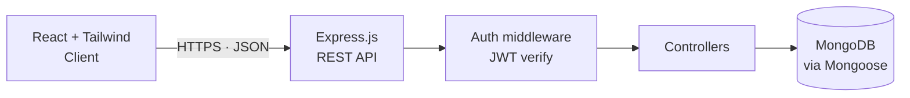
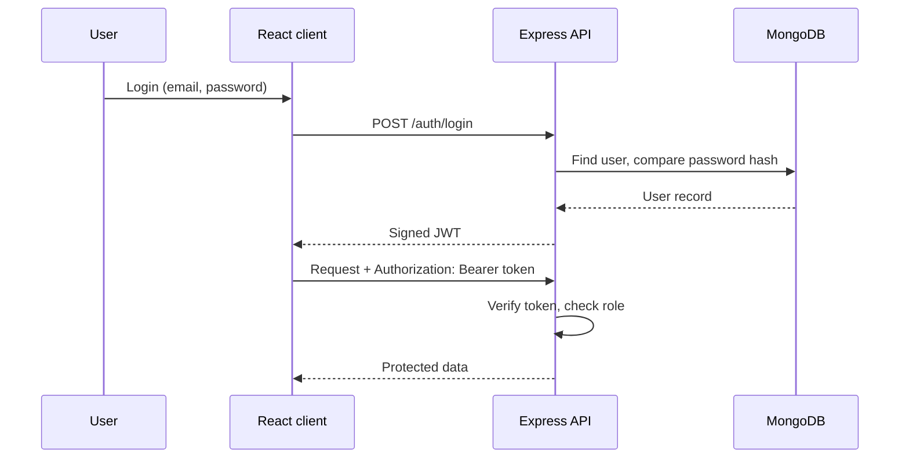

<p align="center">
  
</p>

<p align="center">
  <a href="https://linkedin.com/in/dhanusu-e-9a04023a3"></a>
  <a href="mailto:dhanusu13052004@gmail.com"></a>
  
</p>


## 👨‍💻 About

Final-year **B.Tech Information Technology** student (Pondicherry University, 2026) and **MERN stack developer**. I build responsive interfaces, secure REST APIs and database-driven apps, with internships in MERN development, Python and UI/UX design. I'm looking for an entry-level Software Developer role.

```ts
const dhanusu: Developer = {
  role: "Full Stack Developer (MERN)",
  stack: ["MongoDB", "Express.js", "React.js", "Node.js"],
  auth: "JWT",
  styling: ["Tailwind CSS", "CSS3"],
  alsoKnows: ["Python", "SQL", "Figma"],
  openToWork: true,
};
```


## 🧰 Tech Stack

| Area | Technologies |
|:--|:--|
| **Frontend** | React.js · JavaScript (ES6+) · HTML5 · CSS3 · Tailwind CSS |
| **Backend** | Node.js · Express.js · REST APIs · CRUD · JWT Authentication |
| **Database** | MongoDB · Mongoose · SQL |
| **Languages** | JavaScript · Python |
| **Tools** | Git · GitHub · VS Code · Postman · Figma |

<p>
  
  
  
  
  
  
  
  
  
  
</p>


## 🛒 Featured Project: Blueshell E-Commerce Platform

Full stack MERN e-commerce app with a responsive UI, REST APIs and JWT-secured authentication.

**Architecture**



**Authentication flow**



<details>
<summary><b>Technical details</b></summary>

- **Frontend:** component-based React.js UI styled with Tailwind CSS, responsive across screen sizes
- **Backend:** RESTful APIs in Node.js and Express.js with CRUD operations
- **Database:** MongoDB with Mongoose schemas and models
- **Security:** JWT-based authentication and authorization
- **Tested with:** Postman during API development

</details>


## 🚀 Other Projects

| Project | What it does | Tech |
|:--|:--|:--|
| 🏥 **Hospital Appointment Booking** | Online appointment booking with form handling and validation of appointment details | HTML · CSS · JavaScript |
| 🧳 **Tourism Management System** | Manages tourism details, listings and bookings with structured data storage | Web app |
| 🫁 **Lung Disease Prediction** | Predicts lung disease from user input and medical data, and displays the result | Python |


## 💼 Experience

| Role | Company | Highlights |
|:--|:--|:--|
| **MERN Full Stack Intern** | Valvanet Technologies | Built full stack features, responsive React components wired to REST APIs, and MongoDB schemas with CRUD |
| **Python Intern** | Tidal Neo · HTGE-Technology | Python development tasks, strengthening core programming and problem solving |
| **UI/UX Design Intern** | HighKon Medias | Layouts, wireframes and prototypes in Figma for web apps |


## 🎓 Education

| Degree | Institution | Years | Score |
|:--|:--|:--|:--|
| B.Tech, Information Technology | Raak College of Engineering & Technology, Puducherry (Pondicherry University) | 2022 – 2026 | CGPA 8.0 |
| HSC | St. Joseph's Higher Secondary School | 2021 – 2022 | 70% |
| SSLC | St. Joseph's Higher Secondary School | 2019 – 2020 | 76% |


## 📫 Let's Connect

[](https://linkedin.com/in/dhanusu-e-9a04023a3)
[](mailto:dhanusu13052004@gmail.com)
